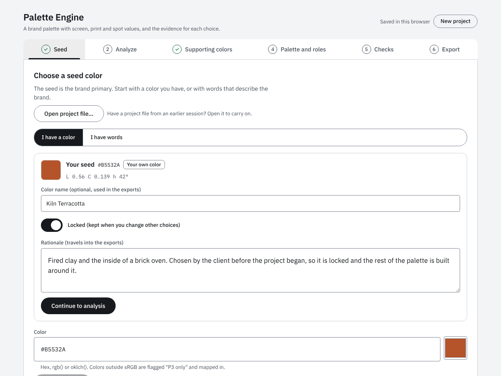
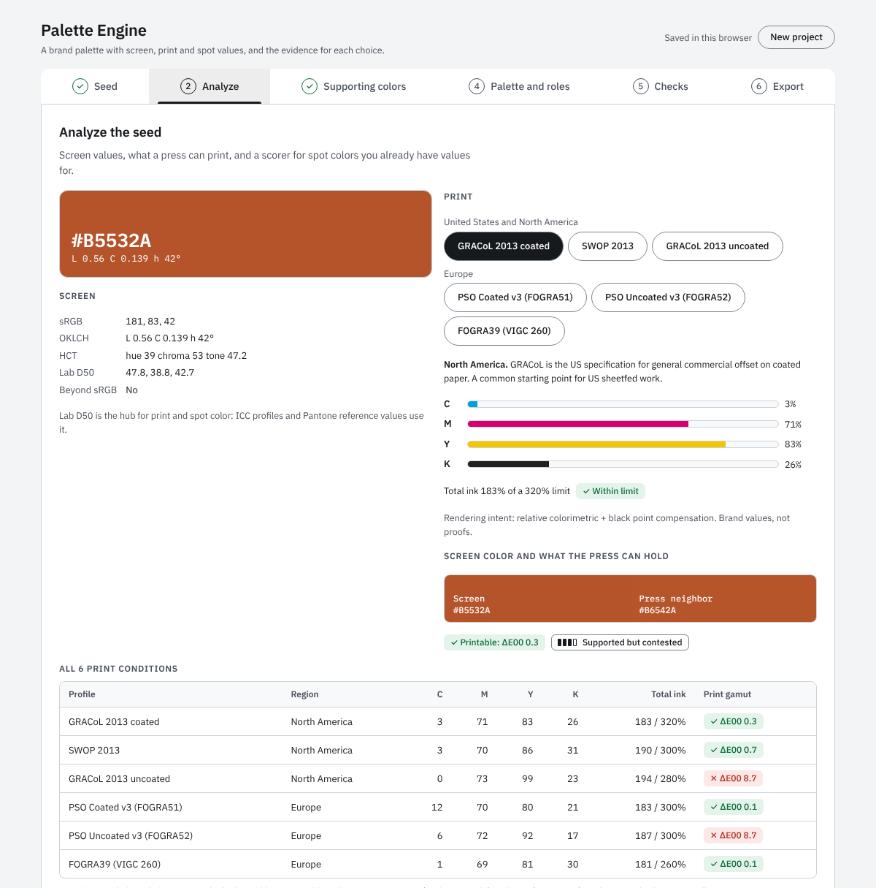
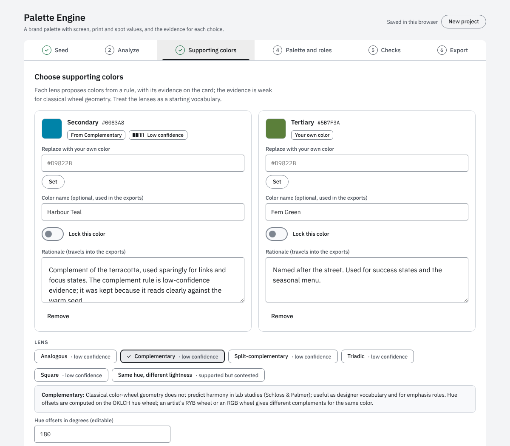
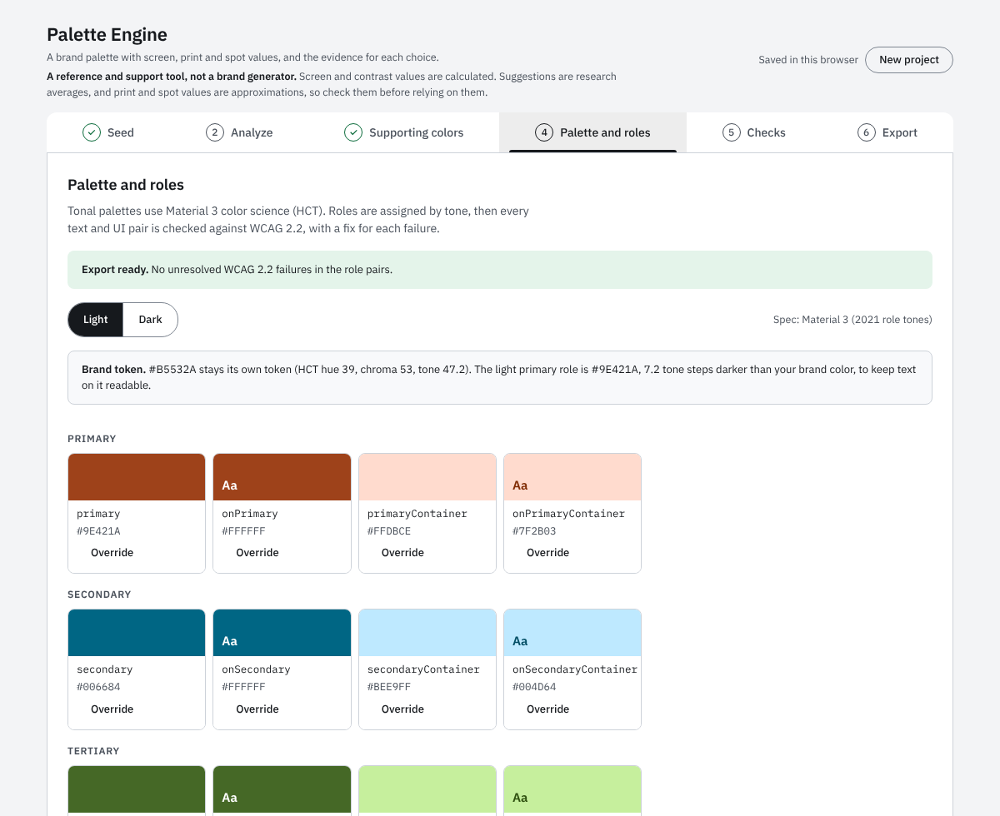
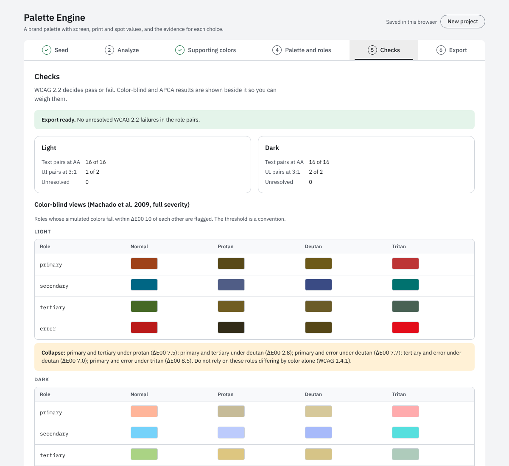
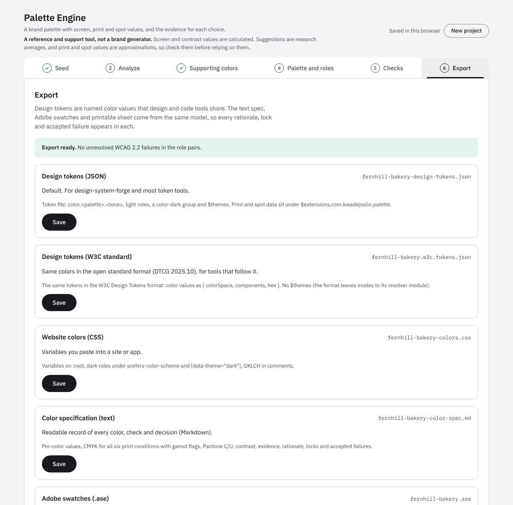
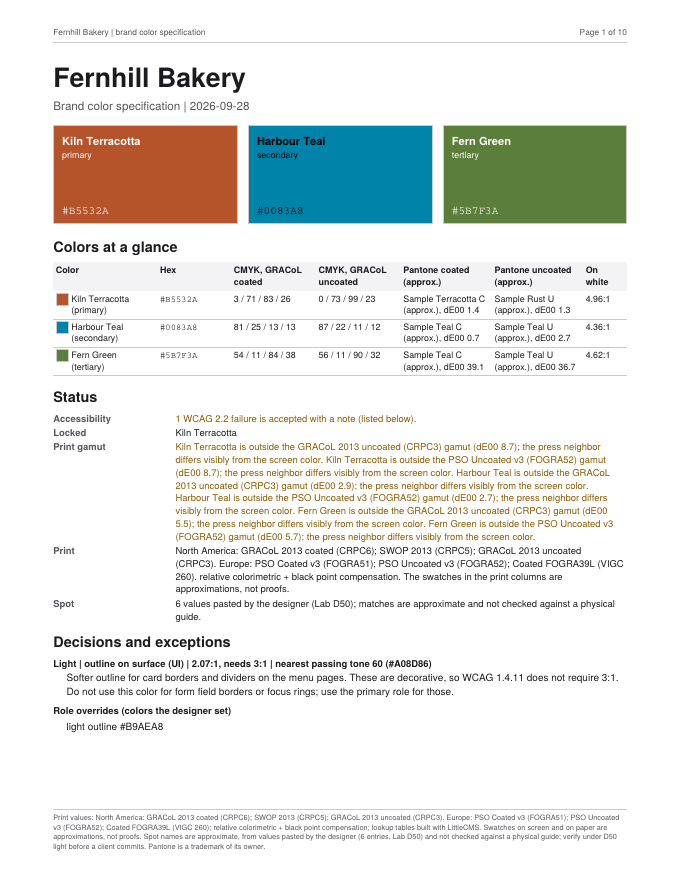
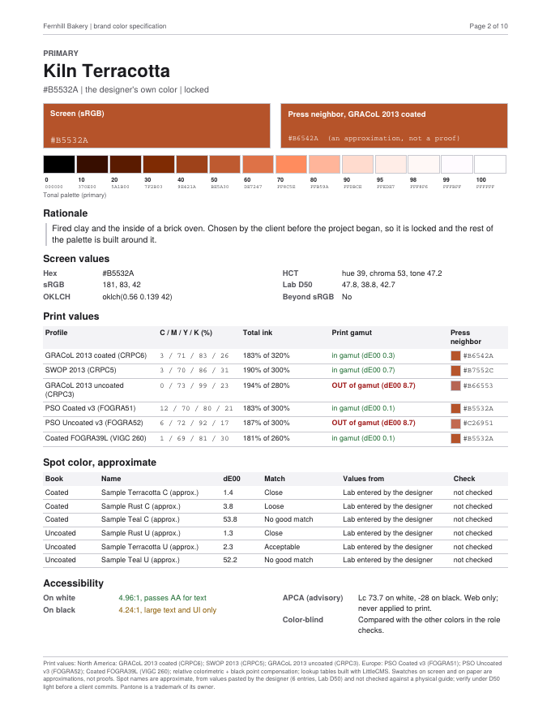

# Palette Engine

A brand-palette builder for designers. Start from a color you already have, or from words that describe the brand, and end with a
documented palette: screen values, CMYK for six print conditions (three US, three European), approximate spot-color matches you supply, light and dark
color roles, accessibility checks, and files that design and print tools can read. Every suggestion shows how strong the evidence behind
it is, and every choice the designer makes (lock, override, note) travels into the exports.

It is a personal design-systems project by Kwade Joslin, designed and reviewed by him and built with Claude (Anthropic) over a series of
phases. [`docs/02-how-it-was-made.md`](docs/02-how-it-was-made.md) says what that means in practice.

> **Status:** phases 0–5 are built and tested; phase 6 (validation) is partly done. The Adobe swatch file (`.ase`) has **not** been opened
> in Illustrator or InDesign, and the Pantone spot-check has **not** been run. See [TO-CONFIRM.md](TO-CONFIRM.md).

## What it does

1. **Seed.** Enter a color (hex, `rgb()`, `oklch()`), or pick descriptor words (calm, trustworthy, bold…) and choose from 3–5 candidates.
   Colors outside sRGB are flagged "P3 only" and mapped in, with the original kept. A saved project file can be opened from this step too, to carry on where you left off.
2. **Analyze.** Screen values (sRGB, OKLCH, HCT, Lab D50); CMYK and total ink for six print conditions, grouped by region (North America: GRACoL 2013 coated, SWOP 2013, GRACoL 2013 uncoated; Europe: PSO Coated v3, PSO Uncoated v3, a FOGRA39 file);
   a print-gamut flag with the nearest printable color; a scorer that ranks spot colors the designer pastes in.
3. **Supporting colors.** Harmony lenses (analogous, complementary, split, triadic, square, empirical) with the evidence tier on each card.
4. **Palette and roles.** Material 3 tonal palettes and 29 light/dark roles, built with HCT. Every text and UI pair is checked against WCAG 2.2;
   each failure carries a nearest passing fix. Colors can be locked, overridden, and given a rationale note.
5. **Checks.** WCAG 2.2 (the pass/fail gate), color-blind views (Machado 2009), APCA (advisory, web only), print legibility, color origins.
6. **Export.** Design tokens (JSON and W3C standard), website colors (CSS), a text specification (Markdown), Adobe swatches (`.ase`), a printable
   brand color sheet (PDF), and a project file to save and reopen the work.

Two rules run through everything:

- **Evidence is ranked, never hidden.** Suggestions carry one of four tiers: *well-established*, *supported but contested*, *low confidence*,
  *speculative*. Accessibility is shown beside the tier and never silently reorders or removes a candidate; filters are opt-in and list what they hide.
- **WCAG 2.2 decides pass or fail.** Unresolved AA failures block export unless fixed or accepted with a written note (the note travels into the exports).

## What it looks like

Everything below comes from the fictional Fernhill Bakery sample in [`examples/fernhill-bakery/`](examples/fernhill-bakery/) (invented brand and spot names, no Pantone
data). The step images are cropped to the top of each step.

**1. Seed.** Start from a color you have, from words, or from a saved project file (the Open project file button). The brand color can be named, locked and given a rationale, and that note travels into every export.



**2. Analyze.** Screen values, CMYK and total ink for six print conditions, a print-gamut flag with the nearest printable color, and a scorer for spot colors you paste in.



**3. Supporting colors.** Harmony lenses propose secondary and tertiary colors, each with the strength of its evidence on the card.



**4. Palette and roles.** Material 3 roles in light and dark, with every text and UI pair checked against WCAG 2.2.



**5. Checks.** WCAG 2.2 decides pass or fail. Color-blind simulations and APCA sit beside it, as advice.



**6. Export.** Six formats plus a project file, all from one model.



### What the exports look like

The printable brand color sheet (PDF) opens with the brand colors and a summary, then gives each color a page. Page 1 and the first color page of the sample:




Website colors (CSS) are plain variables with the OKLCH value in a comment:

```css
:root {
  color-scheme: light;

  /* Brand colors (your own hex, kept exactly) */
  --color-brand-primary: #b5532a;  /* Kiln Terracotta:  oklch(0.56 0.139 42) */
  --color-brand-secondary: #0083a8;  /* Harbour Teal:  oklch(0.57 0.109 226) */
  --color-brand-tertiary: #5b7f3a;  /* Fern Green:  oklch(0.55 0.106 132) */
```

Design tokens come in two files, one for design-system-forge and most token tools and one in the W3C Design Tokens format (DTCG 2025.10). Each color carries its print
values for all six conditions under an extension key, for example the first tone of the primary palette:

```json
"0": {
  "$value": { "colorSpace": "srgb", "components": [0, 0, 0], "alpha": 1, "hex": "#000000" },
  "$type": "color",
  "$extensions": { "com.kwadejoslin.palette": { "print": { "gracol2013_crpc6": { "cmyk": [83, 74, 61, 100], "tac": 318, "inGamut": false } } } }
}
```

The text specification (Markdown) records every color, check, rationale and accepted failure in readable form. The Adobe swatch file (`.ase`) holds four groups
(Screen RGB, Print GRACoL coated CMYK, Print uncoated CMYK, Spot approximations) and cannot be shown as a picture; it has not been opened in Adobe applications.
The full set of outputs is in [`examples/fernhill-bakery/output/`](examples/fernhill-bakery/output/).

## Quick start

Requires Node 20.19 or later (CI runs 22).

```bash
npm install
npm run page                # bundles the engine, then builds dist/site (for the claude.ai artifact) and dist/site-hosted (a complete page for any static host)
npx serve dist/site-hosted  # or any static server; the page loads its print data from data/, so opening index.html from disk will not work
npm test              # all engine, export and browser tests
```

The browser tests need Chromium. They look in `PE_CHROMIUM`, then a standard Playwright install; run `npx playwright-core install chromium`
if none is found.

See a finished run without the UI: [`examples/fernhill-bakery/`](examples/fernhill-bakery/) holds a fictional brand's project file and every export
generated from it (`npm run example` rebuilds them; a test fails if they go stale).

## Repository layout

```
engine/        The color engine (plain JavaScript modules) and its unit tests
  export/      Export builders: tokens, CSS, Markdown, ASE, PDF, zip
web/           The page: app.js, style.css, and the browser tests (Playwright)
build/         Bundling and page build; Python build step for the print tables and lexicon
data/          Generated data the page loads: six print lookup tables and the approved lexicon
lexicon/       Lexicon source: hue families, emotion weights, the reviewed draft terms
examples/      A fictional sample brand with all outputs
profiles/      Where the three ICC profiles go for a rebuild (not stored; see its README)
docs/          Documentation: goals, method, architecture, decisions, testing, roadmap, phase log (unverified items are in TO-CONFIRM.md at the root)
```

## Documentation

| Read | For |
| --- | --- |
| [01 Overview and goals](docs/01-overview-and-goals.md) | Why this exists, scope, what it deliberately does not do |
| [02 How it was made](docs/02-how-it-was-made.md) | The process with Claude: phases, who decided what, what went wrong and how it was caught |
| [03 Method and evidence](docs/03-method-and-evidence.md) | The research behind each feature and its evidence tier |
| [04 Architecture](docs/04-architecture.md) | Modules, data flow, build steps |
| [05 Exports](docs/05-exports.md) | Each output format, its structure, and its known limits |
| [06 Testing](docs/06-testing.md) | What is tested, how, and what the tests cannot show |
| [07 Decisions](docs/07-decisions.md) | The decision log |
| [08 Data and licenses](docs/08-data-and-licences.md) | Where every dataset comes from, and the terms that apply |
| [TO-CONFIRM](TO-CONFIRM.md) and [09 Roadmap](docs/09-open-items-and-roadmap.md) | What is unverified, unresolved or wrong, and what could come next |
| [Phase log](docs/phase-log.md) | Phase-by-phase record of results |
| [Spot-check protocol](docs/spot-check-protocol.md) and [log](docs/spot-check-log.md) | The physical-guide check that is still to do |

## Limits worth knowing before you use it

- Print values are lookup-table approximations of an ICC transform (agreeing with LittleCMS to ΔE00 0.15 at the 95th percentile and 0.99 in the worst case, on the printed color, across all six). They are brand values, not proofs.
- **No Pantone data is bundled.** Spot matching works on Lab values you paste from a source you are licensed to use. Names are marked "(approx.)".
  Pantone is a trademark of its owner; this project is not affiliated with it.
- The descriptor-to-color path rests on the weakest evidence in the tool. It narrows a search; it does not choose a color.
- The Ou & Luo (2006) harmony score is advisory. Its equations match the printed paper, but the model was fitted on color patches on gray (R² 0.71), not brand contexts.
- The `.ase` file carries no color profile and has not been tested in Adobe applications.
- Accessibility is built in and partly tested, not certified. Automated checks cover contrast, names and focus in Chromium only, and one screen-reader
  session (NVDA with Firefox) has been run. It found problems that are still open or awaiting a re-test (TO-CONFIRM C13 and C18 to C21).

## License

MIT, © 2026 Kwade Joslin (see [`LICENSE`](LICENSE)), for the project's own code and documentation. The print lookup tables in `data/` are derived from ICC profiles whose owners have answered: PRINTING United Alliance gave permission on condition that its notice is kept, ECI replied that derived tables need no permission and asked for credit, and the FOGRA39 file's registry terms allow sharing. The notices travel with the tables (see [`NOTICE.md`](NOTICE.md) and the page footer); the ICC profiles themselves are not in this repository. Third-party components and data are listed, with their terms, in
[`docs/08-data-and-licences.md`](docs/08-data-and-licences.md).

---

Designed and built by [Kwade Joslin](https://kwadejoslin.com) with Claude. See [`docs/02-how-it-was-made.md`](docs/02-how-it-was-made.md) for how.
